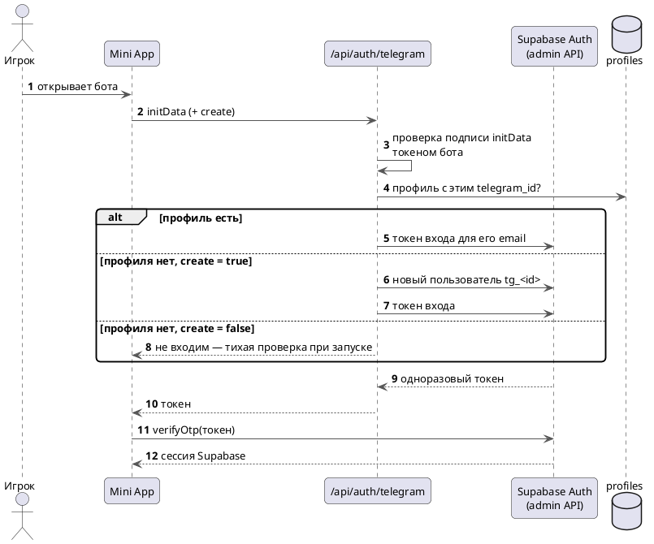

---
tags:
  - архитектура
  - схема
aliases:
  - "Вход"
  - "Аккаунты"
source: "DOCS.md § «Авторизация»"
updated: 2026-10-26
---
# Авторизация

Supabase Auth, email+пароль (см. [[Указатель решений|DECISIONS.md]] почему не magic link/OAuth в v1). Формы входа/регистрации отдельного роута `/auth` больше нет — `AuthForm.tsx` встроена прямо в `screen-profile` (см. [[Указатель решений|DECISIONS.md]], «форма входа встроена в профиль»). Почта подтверждается: регистрация, восстановление пароля и привязка почты к Telegram-аккаунту идут через 6-значный код из письма (`OtpCodeStep.tsx`). Повторная отправка кода доступна через 60 секунд: чаще Supabase одному адресу не пишет. Письма уходят через свой SMTP. Это видно по данным: 30.09 за один час ушло 20 писем с кодами, а встроенная почта Supabase отправляет 2 письма в час и только адресам команды проекта. Часовой лимит писем — Supabase Dashboard → Authentication → Rate Limits (для своего SMTP по умолчанию 30 в час).

`components/providers/AuthProvider.tsx` держит текущую сессию (`supabase.auth.onAuthStateChange`) в React-контексте, используется всем app-shell'ом. **Важно**: `lib/supabase/client.ts` — синглтон (`createClient()` возвращает один и тот же экземпляр на вкладку). Отдельный `createBrowserClient()` на каждый вызов — частая ошибка: `onAuthStateChange` срабатывает только на том экземпляре, который выполнил вход/выход, поэтому форма логина и `AuthProvider` с разными инстансами друг друга не видят без полной перезагрузки страницы. Наступили на эти грабли и в этой сессии — см. запись в [[Журнал изменений|CHANGELOG.md]].

Карта/территории/активность/профиль доступны без входа (просмотр). Попытка нажать «+» без сессии переключает на вкладку «Профиль» (не молча ничего не делает) — а там без сессии сразу форма входа/регистрации, а не пустая заглушка.

## Шаблоны писем Supabase (проверка 26.10.2026)
Приложение везде ждёт 6-значный код, а не переход по ссылке: обработчика ссылок из писем (`type=recovery`, `code=`) в коде нет, ссылка просто открывает приветственный экран. Поэтому в Supabase Dashboard → Authentication → Email Templates в письмах «Confirm sign up», «Reset password» и «Change email address» (привязка почты к Telegram-аккаунту) должен стоять `{{ .Token }}`, а не `{{ .ConfirmationURL }}`. 26.10 «Reset password» оказался со ссылкой, и восстановление пароля не работало; шаблон исправлен и сохранён (проверено перезагрузкой страницы: сохранение в панели легко теряется, если не дождаться тоста «Successfully updated email template»). Два других шаблона в тот день были в порядке. Шаблоны живут только в панели Supabase, в репозитории их нет: при смене проекта или сбросе настроек проверить заново.

Экран восстановления пароля (`recoveryMode` в `FishZoneApp.tsx`) проверяется раньше экрана загрузки: код из письма сразу создаёт сессию, и если бы загрузка шла первой, экран потерял бы шаг «новый пароль», а игрока пустило бы в аккаунт без смены пароля (так было до 26.10).

## Вход через Telegram Mini App

Supabase не умеет «войти через Telegram», поэтому сервер проверяет подпись `initData` токеном бота и выпускает одноразовый токен входа через admin API (`/api/auth/telegram`). Email-аккаунт может привязать Telegram: из профиля (`/api/telegram/link-token` → бот `/start link_…`) или внутри Mini App (`/api/auth/telegram/link`).

Связанные заметки: [[API-маршруты]]

## Сбой тихого входа (с 23.10.2026)
Вход при запуске Mini App — один запрос к своему серверу и один к Supabase, и любой мог попасть в медленный момент (23.10 Supabase Auth дважды ответил таймаутом 500/504). Раньше одна неудача отправляла игрока на первый экран, будто аккаунта нет.
- `lib/telegram/signIn.ts` теперь возвращает `ok`, `no_account` или `failed` и один раз повторяет попытку через 1,5 с после сетевой ошибки или ответа 5xx (с новым токеном, старый мог уже сгореть). Отказ по подписи и «нет аккаунта» не повторяются.
- `/api/auth/telegram` пишет причину отказа в `client_errors` под `api:auth/telegram`: подпись `initData` не сошлась или она старше 24 часов (с возрастом `auth_date`), а в ответе 500 теперь текст ошибки Supabase. Тревога в Telegram приходит от 3 таких записей за 10 минут.
- Если тихий вход внутри Telegram не прошёл, на первом экране есть кнопка «Войти через Telegram» (`signInWithExistingTelegram`): входит только в уже существующий аккаунт и говорит, почему не вышло.
- Из браузера (не Mini App) Telegram не сообщает, кто это, поэтому вход только по почте и паролю; для аккаунта, созданного через Telegram, почту привязывают в профиле заранее.

## Полный экран (с 16.10.2026)
`AuthProvider` просит `requestFullscreen` только на телефонах (`WebApp.platform` — `ios`, `android`, `android_x`). В Telegram Desktop, macOS и Web тот же запрос разворачивал окно на весь экран компьютера, поэтому там его нет, а если Telegram уже открыл мини-приложение полноэкранным (режим запуска в BotFather) — вызывается `exitFullscreen`.

## См. также
- [[API-маршруты]]
- [[Уведомления в Telegram]]
