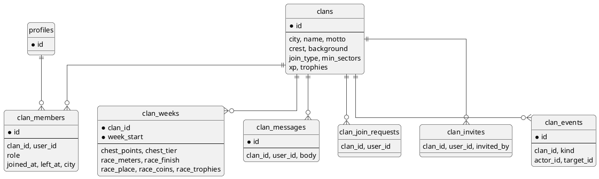

---
tags:
  - механика
  - кланы
  - схема
aliases:
  - "Клан"
source: "DOCS.md § «Кланы»"
updated: 2026-11-13
---
# Кланы

Клан привязан к городу. Создать — игрок с 3+ захваченными секторами, 700 монет. Вступить — в открытый сразу, в остальные по заявке или приглашению.

- Данные: `clans`, `clan_members` (с историей — `left_at`/`left_reason`), `clan_join_requests`, `clan_invites`, `clan_events` (журнал), `clan_weeks` (итоги недели: сундук, битва кланов, `race_void`).
- Экраны: `ClanListScreen` (поиск, приглашения, создание), `ClanScreen` (шапка `ClanHero`, вкладки «Участники / Сундук / Битва кланов», блок модерации для супер-админа), `ClanEditorScreen` (создание и настройки, 4 шага с живым превью), `ClanRaceScreen` (битва кланов целиком). Вход — карточка клана в профиле, пилюля в чужом профиле, строка клана на экране сектора, вкладка «Кланы» в рейтинге, ссылка `?clan=ID`.
- Герб — `ClanCrest` (форма + символ + два цвета, `lib/data/clanCrests.ts`), фон — `lib/data/clanBackgrounds.ts`, уровни/лиги/роли — `lib/data/clanLevels.ts`.
- Карта, верх — одна панель `.map-hud` на всю ширину (MapScreen): логотип и переключатель «Игроки | Кланы» в первой строке, под ними легенда в одну строку (мои / чужие / свободные, либо гербы топ-3 кланов с числом секторов и «Без клана»), а у игрока в клане — оранжевый низ панели «Битва кланов» (`MapRacePill`: место или % пути, время до итогов, полоска прогресса). Слой «Кланы»: сектора в цвет герба владельца, одиночки серые, на метках гербы; выбор слоя запоминается на устройстве.
- **Список участников** (вкладка «Люди» с обновлением кланов): справа два числа — уловы за неделю (подпись «ул/нед», с 18.11.2026; раньше «уловов за нед.» на iPhone наезжала на имя) и монеты в общак за месяц. Столбцы фиксированной ширины (46 и 64 px, `.c2-roster` в `app/clan2.css`), имя и роль занимают остальное и обрезаются многоточием. Место под кнопку «…» в строках без меню держится, только если меню есть хоть у одного участника.
- **Что видно о чужом клане** (решение владельца 09.11.2026): уровень клана, где стоит штаб, осада и руины, база с шестью постройками и их **уровнями** (все шесть, в том числе крепость и маяк). Не показывается и сервером не отдаётся: баланс и журнал общака, ставка отчисления, план бафа «Выход», кто и сколько вносил. На экране чужого клана (вкладка «Участники») карточка базы `ForeignBase` (`components/clan2/live/ForeignBase.tsx`) на данных `get_clan_bases`; показывается, только если штаб чужого клана есть в списке карты текущего города и пришёл с сервера (условные постройки предпросмотра за настоящие не выдаются); для клана другого города карточки базы нет (на его сектора нет карты этого города).
- **Вкладка «Кланы» на экране «Сектора»** (`ClanRating`): рейтинг кланов своего города (подиум и список до 30, кнопка «Все кланы города»), а под ним блоки по остальным городам, где есть кланы (до 10 кланов на город, строка как у своего списка, заголовок — название города). Данные те же `list_clans` по каждому городу (миграции не нужны), ключи запросов общие с `useClanList`. Клан другого города можно открыть и посмотреть, вступить в него нельзя (экран клана пишет, что он в другом городе).
- **Роли и кто кого двигает** (`set_clan_member_role`, меню участника в `ClanScreen`): глава назначает кого угодно и один передаёт руководство (прежний глава становится соруководителем). С 09.11.2026 соруководитель (в FAQ «заместитель») может поднять участника и старейшину до старейшины и соруководителя, а старейшину опустить до участника; других соруководителей и главу он не трогает, себя тоже. Раньше соруководитель двигал только участник ↔ старейшина. Черновик: `supabase-drafts/clan-coleader-promote-09-11/`.
- **Рамка герба в списках** (13.11.2026): рамка из магазина клана видна в списке кланов города (`ClanListScreen`) и во вкладке «Кланы» (`ClanRating`, подиум и строки) через `FramedCrest` (`components/clan2/ClanItems.tsx`) и `useClanFrames()` (таблица `clan_equipped`). Карточка клана для истории («Люди → Слава») — на фоне клана и с его рамкой.
- **Осада штаба закрывает общак** (решение владельца 13.11.2026): пока у клана идёт осада, из общака ничего не тратится (магазин, постройка, ускорение, «Выход», перенос штаба); вклады, рента и отчисления приходят. В приложении — `siegeLocked` в `lib/clan2/demoStore.ts`, на сервере — проверка в `_clan_treasury_spend` (`web/supabase-drafts/clan-siege-lock-13-11`, применено 13.11.2026). Добыча при падении (20 % общака, не больше 1 500): три четверти — в общак клана нападавшего, нападавшему без клана — на его счёт, четверть пропадает (`clan_hq_tick`). Уровни построек хранятся у клана (`clan_treasury.projects`), без штаба спят (`_clan_project_level` даёт 0) и снова работают с новым штабом на любом секторе клана. Первое восстановление штаба после падения бесплатное, один раз за всё время клана (решение владельца 13.11.2026; `clan_treasury.hq_free_rebuild_used`, `clan_hq_free_rebuild`, `clan-hq-free-rebuild-13-11`), следующие — по `hq_place_cost` (1 000).
- **«Приход за 7 дней» на вкладке «Общак»** (16.11.2026): семь столбиков — календарные дни по местному времени телефона (сегодня и шесть дней до него), под столбиком день недели, над ним сумма прихода за день (все поступления: рента, взносы, отчисления, доли, задания, возвраты). Живой клан рисует столбики только по полному журналу недели с сервера (`readWeekLog`), не по последним 50 строкам состояния. `TreasuryTab.tsx`, стили `.c2-flow*` в `app/clan2.css`.
- **«Выход» на экране** (16.11.2026): эффекты — «×2 монеты за улов» и «×1,5 метра в Битве кланов» (очки сундука «Выход» не меняет, см. `11_buff_meters`). Счётчик «Бонус за этот выход» показывается только в демо: живой клан бонус с сервера не получает, и раньше там всегда было «+0». Слова о монетах игрока везде «на счету» (как в магазине), не «на кошельке».
- **Значок постройки на схеме базы** (решение владельца 16.11.2026, `BaseScene.tsx`, у чужого клана `BaseView.tsx`): у построенной — её уровень («1», «2»), на последнем уровне — «MAX»; у непостроенной — «+» (оранжевый: можно построить сейчас, серый: пока нельзя). Раньше у построенной, которую можно улучшить, вместо уровня стоял «+», и после нового штаба казалось, что постройки пропали.
- **Подарочные монеты не идут в общак** (просьба владельца 17.11.2026, против новых аккаунтов, которые вкидывают стартовые монеты в клан): приветственный бонус (`welcome_bonus`, 150) и бонус за вход по приглашению (`referral_welcome`, 100) внести в общак нельзя. Подарок тратится первым на любые другие траты (магазин, щиты, задания…); непотраченный остаток лежит на счету, но не вносится: можно внести `монеты − max(0, подарки − траты)`. Взносы тратами не считаются (иначе каждый взнос «съедал» бы подарок), кроме взносов до правила (до 17.11.2026 15:30 UTC), чтобы никто не платил дважды. Сервер: `_clan_gift_locked(uid)` (закрыта для игроков), `clan_treasury_donatable()` (сколько можно внести сейчас), отказ `CLAN:gift_coins` в `clan_treasury_donate` (`web/supabase-drafts/clan-gift-coins-17-11`). В приложении окно взноса (`TreasuryTab.tsx`) спрашивает `clan_treasury_donatable` при открытии; сумма больше — вместо взноса открывается окно «Эти монеты нельзя внести» с тем, сколько можно внести сейчас.
- У игрока может быть клан в каждом городе; всё, что «мой клан», — это клан текущего города профиля. Действия в клане передают `clanId` явно.
- **Кланы в профиле** (17.11.2026): в своём профиле видны карточки всех кланов игрока — сначала клан текущего города (из профиля), потом кланы других городов в порядке городов (`useMyClans` → `clan_members` + `clans`, без распущенных). Карточки и «Где это?» идут сеткой в 2 столбца; если карточек нечётное число, последняя растягивается на всю ширину (класс `.profile-duo-wide`). Когда кланов больше одного, сверху на карточке — город, под именем — роль; с одним кланом карточка как раньше (сверху роль). Нажатие открывает экран этого клана. Счётчик непрочитанного чата — только у клана текущего города. Фон карточки (решение владельца 17.11.2026) — тёмно-серый со свечением сверху цвета герба (`clanCardBackground` в `lib/data/clanCrests.ts`): основной цвет герба; если он чёрный — цвет обводки; чёрный с белой или кремовой обводкой — мягкое белое свечение. Выбранный кланом фон шапки сюда не берётся.
- Гербы у имён: в недельном рейтинге (`useClanBadges` → `get_clan_badges`, запрос только когда открыт рейтинг) и на карточках секторов (`ownerClanCrest` из `territories_with_stats`).
- Хуки — в `lib/supabase/queries.ts` (`useClan`, `useClanList`, `useClanChest`, `useClanRace`, `useClanBadges`, `useAdminModerateClan` и т.д.); после изменения членства — `invalidateClanMembership()`.
- Общий сектор: улов соклановца на секторе клана (клан города сектора) добавляет его в `territory_shares` — до 4 держателей вместе с хозяином, пятый просто поддерживает. `territories_with_stats.co_holders` → `Territory.coHolders` (у каждого `isMe`). Хозяин (`owner_id`) остаётся хозяином для щита и битвы кланов. Счётчик секторов (`profiles_with_stats.territories_count`: «Все игроки», админ-список) считает владение плюс доли, как карта и «Мои» (с 18.10; раньше считал только владение). В рейтинге недели (и его итогах) и в достижениях доля считается целым сектором: `_weekly_sector_counts` на сервере, `heldTerritories()` в `lib/data/achievements.ts` на клиенте. Смена хозяина (чужой захват, модерация, перенос улова) обнуляет доли и шлёт бывшим совладельцам «сектор забрали» (триггер `territories_owner_changed`); выход из клана снимает доли ушедшего и доли на его секторах (`clan_members_left_shares`).
- «Захватил сектор» на общем секторе — держатель (хозяин или совладелец) с самым свежим уловом на этом секторе: `territories_with_stats.capturer_id` → `Territory.capturerId`, выбор — `lib/data/sectorHolders.ts`. Остальные держатели — в «Совладельцах». Хозяин в базе (`owner_id`) от этого не меняется.
- Рисунок общего сектора — `lib/map/sectorParts.ts` (`splitSector`): сота режется на 2 (верх/низ), 3 («Y») или 4 («+») равные части, часть 0 — хозяину. На карте части — отдельные неинтерактивные полигоны под контуром соты, линии разреза белые, аватарки в центрах частей, номер в центре соты; на слое «Кланы» — один герб. На экране сектора — то же на мини-карте (`TerritoryThumbnailMap`) и блок «Совладельцы»; своя часть — своим цветом, значок «Моя доля».

- Возврат в клан (`_clan_join_problem`, им же проверяют `join_clan`, `invite_to_clan`, `respond_clan_join_request`): после любого выхода или исключения игрок 24 часа не может вступить ни в один клан своего города (`cooldown`); исключённый в тот же клан не вернётся 72 часа после исключения (`kicked_recently`, и приглашение, и заявка). Вышедший сам вернуться может через сутки. Текст отказа называет срок (с 18.10); в FAQ — вопрос «Я исключил игрока… когда можно позвать обратно?».

## См. также
- [[Чат клана]]
- [[Сундук недели и битва кланов]]
- [[Номер клана и церемония битвы]]
- [[Сектора, защита и щит]]

- **Карточка клана в историю** (20.11.2026): «Зал славы» → «Карточка клана» → «Поделиться в истории» (`GloryTab.tsx`). Картинка 1080×1920 рисуется сервером — `app/api/clan-story/[clanId]?lang&v`: фон и свечение в цвете герба (`clanStoryColors` в `lib/data/clanCrests.ts`: глубокие оттенки основного цвета герба, за гербом — его светлый тон; у чёрного или белого герба — цвет обводки; с 20.11.2026, раньше — фон из редактора), герб (`crestSvgMarkup`), название, уровень (`clanLevel(xp)`) и лига, штаб (`clan_hq`), число участников, три рекорда клана с рисунками рыб (`public/fish/story`) — считаются как в «Зале славы» (уловы участников в секторах города клана, самая длинная рыба вида), и «Вступай в наш клан!» (белая плашка, текст — тёмный оттенок цвета герба). Превью «Карточка клана» в «Зале славы» в тех же цветах. В Telegram — `shareToStory` с подписью «Вступай в клан … @catchrangebot» и, у Premium, ссылкой на клан (`?clan=<id>`, с кодом приглашения для старейшины и выше, + `ref`). В демо-клане (без настоящего id) кнопка только говорит, что делает. Раньше кнопка «Поделиться» копировала текст с рекордами без ссылки.

