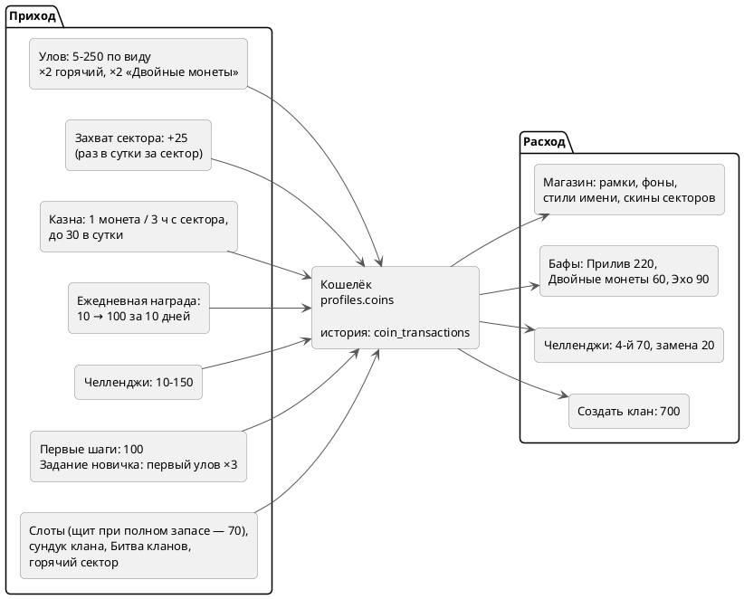

---
tags:
  - механика
  - схема
aliases:
  - "Монеты"
  - "Экономика"
  - "Магазин"
  - "Бафы"
  - "Казна"
updated: 2026-11-27
---
# Монеты и экономика

Баланс — `profiles.coins`, каждое движение — строка в `coin_transactions` (у монет за улов есть `catch_id`, чтобы модерация могла их вернуть). Числа сверены с базой и кодом; для игроков они в FAQ (`web/lib/data/faq.ts`, раздел «Монеты»), там же таблица цен по видам рыб (`species.coin_value`).

- Монеты за улов зависят только от вида: от 5 до 250. Горячий сектор ×2, «Двойные монеты» ×2 (вместе ×4).
- Задание новичка (с 31.10.2026): первый улов в первые 7 дней после регистрации — к цене вида ещё две цены (`catch_reward` с `catch_id`, «Задание новичка: первый улов ×3») и щит в запас (до 3), один раз; триггер `catches_newbie_bonus` → `_newbie_first_catch_bonus`. Множители горячего сектора и «Двойных монет» на бонус не действуют. Отсчёт на плашке «Первые шаги» (`newbie_until` в `_first_steps_state`), напоминания в Telegram на 3-й и 6-й день (`onboarding_due`: `new_day3`, `new_day6`).
- **Отчисление с улова в общак клана** (ставка 0 / 5 / 10 %, её ставит глава или заместитель; триггер `clan_tax_on_catch` на `coin_transactions`, берётся только с награды за улов `catch_reward`): с 09.11.2026 не меньше 1 монеты с награды, раньше `floor(награда × ставка / 100)` при награде 15 и ставке 5 % давал 0 и отчисление не приходило совсем. С награды в 1 монету ничего не берётся (отчисление не больше награды минус 1). Из-за минимума на мелких наградах фактический процент выше номинального: награда 5 при ставке 5 % даёт 1 монету (20 %), награда 15 — 1 монету (6,7 %). Черновик: `supabase-drafts/clan-tax-min-09-11/`.
- «Двойные монеты» удваивают уловы, захваты, челленджи, достижения и награды клана; Казну, ежедневную награду и слоты — нет.
- **С 09.11.2026 личная Казна закрыта и «Двойные монеты» не продаются** (`retire_personal_treasury`, клановое обновление): сектора приносят ренту в общак клана. Схема выше и строки про Казну — история до 09.11. «Первые шаги» с 09.11 — пять шагов (поймать, укрепить сектор, ежедневная награда, челлендж, клан), шаг «Забери Казну» убран (`supabase-drafts/first-steps-no-treasury-09-11`), награда та же — 100. Окно с монетой у логотипа на карте (`RewardsModal`) с клановым обновлением — только ежедневная награда, без вкладки «Казна» (до 09.11 там было две вкладки); значок появляется, только пока сегодняшняя награда не забрана.
- Слоты: 1 бесплатный прокрут в день и по одному за улов, до 4; джекпот 0,3% (рамка «Катран» / «Сом»). День прокрутов — календарная дата по городу игрока; с 26.11.2026 (черновик `slots-day-26-11/01`) у каждого прокрута записана его дата (`slot_spins.spin_day`), и смена города не даёт второй бесплатный прокрут за ту же дату. Щит (3%, до 27.11.2026 было 5%; черновик `slots-shield-3-26-11`, освободившиеся 2% ушли в «пару»: 28,5% → 30,5%, без бокса 38% → 40%) — единственный источник щитов: в запас до 3, сверх — 70 монет.
- Рейтинг недели (черновик `economy-24-11/10`, с выпуском бокса): топ-3 города — 300 монет + ключ (бесплатный бокс), 200, 100; только при хотя бы 1 секторе недели.
- Награды-медали и баф «Двойные монеты» (черновик `economy-24-11/16`, 25.11.2026, владелец: «баф не должен влиять на приз в рейтинге и награды», «замени призы рейтинга на актуальный»): монеты за медаль больше не удваиваются; за рейтинг недели старого бонуса медали 150/100/60 нет — остаётся только приз 300 + ключ, 200, 100 (в «Активности» и в боте он и показан, с «и ключ» у 1 места). Другие медали — 80 хранитель, 100 улов месяца, 70 молния, 150 легенда сезона, 60 ночной страж, 90 дуэлянт — без бафа. Уловы, захваты, челленджи, достижения и награды клана по-прежнему ×2 от бафа.
- Слоты с боксом (черновик `economy-24-11/09`, 25.11.2026; до выпуска только суперадмин, у остальных по-старому): 3 ключа (в базе символ `chest`) — бесплатное открытие секретного бокса (1,5%; копится, не сгорает, тратится первым вместо 500), «Ассорти» — три разные рыбы, 15 монет (8%); «пара» 38% → 28,5%, «Ничего» прежнее ≈ 24,7%. Прогон 4 000 прокрутов: сундук 1,3%, «Ассорти» 7%, пара 28,5%, мимо 24,7%.
- Щиты не продаются с 07.10.2026 — [[ADR-28 Щиты только из слотов, запас до 3]].
- «Где это?» (с 09.10.2026): угадал сектор панорамы дня — +30; улов в этом секторе до полуночи — ещё +50 (задание дня); раз в день, без «×2» — [[Где это]].

- **Секретный бокс** (с 24.11.2026, черновик `web/supabase-drafts/economy-24-11/03`): 500 монет за открытие, открывать можно сколько угодно. Внутри — любая вещь магазина, что продаётся за монеты (73 вещи с новинками; без бесплатных фонов и призов слотов); шансы по цене 70 / 22 / 6 / 2 % (с 07, 25.11; было 74 / 20 / 5 / 1). Вещь, которая уже есть, превращается в половину её цены монетами (вниз до 10). С 06 (черновик 25.11): каждый 4-й приз в группе — монеты: 150/250, 500, 1 000, 2 500; средняя отдача ≈ 410. Средняя цена выпавшей вещи ≈ 440 (88 % цены бокса), без учёта повторов; эпическая или легендарная — примерно 1 раз из 16. До выпуска (`05_release.sql`) бокс и 16 новинок видит только суперадмин. Открывается на своём тёмном экране (как слоты): сундук трясётся, раскрывается, лента вещей ~6 с тормозит на призе, потом карточка приза с «Надеть» или «повтор, +N». `SecretBox.tsx` (карточка в магазине), `SecretBoxScreen.tsx` (экран).
- **Значок NEW** у новинок магазина: 7 дней от первого захода игрока после их появления (`shop_new_items`, `shop_novelties`, `shop_novelty_seen`).
- **Награды сундука и битвы** с 24.11.2026 — только тем, кто за неделю поймал хоть одну рыбу ([[Сундук недели и битва кланов]]).
- Разбор экономики 24.11.2026 (страница «Экономика RANGE · ноябрь»): ~103 монеты в день на активного игрока, за рыбалку ~30; главная трата — общак клана.

## См. также
- [[Сектора, защита и щит]]
- [[Сундук недели и битва кланов]]
- [[Фиксация улова]]
