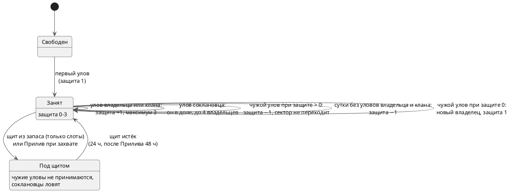

---
tags:
  - механика
  - схема
aliases:
  - "Сектор"
  - "Защита"
  - "Щит"
  - "Прилив"
  - "Горячие сектора"
updated: 2026-11-14
---
# Сектора, защита и щит

Вода Батуми и Москвы поделена на шестиугольные сектора (id `B0144`, `M3291`; сетка — [[Генератор сетки секторов]]). Правила для игроков — в FAQ (`web/lib/data/faq.ts`, раздел «Сектора»); здесь — как они устроены.

## Жизнь сектора

## Правила

- Свободный сектор становится твоим с первым уловом, защита — 1.
- **Защита 0–3** (`territories.defense`, `defense_at`): улов владельца или его клана +1 (максимум 3); чужой улов −1, сектор не переходит; без уловов владельца и клана защита тает на 1 в сутки. При защите 0 следующий чужой улов забирает сектор.
- **Клан:** соклановцы не отнимают сектора друг у друга — улов добавляет соклановца в долю (`territory_shares`), до 4 владельцев; в рейтинге, профиле и достижениях это целый сектор каждому.
- **Щит** (`territories.shield_until`): 24 часа чужой улов сектор не захватывает, соклановцы ловят как обычно. Живой улов чужого рыбака `confirm_catch` отклоняет (`SHIELDED:<до когда>`), и окно «Сектор под щитом» предлагает «Добавить в дневник»: с 04.11.2026 это тот же `confirm_catch`, но с моментом снимка, то есть «опоздавший» улов: он идёт в статистику, челленджи, награды и монеты за вид, а сектор, защита и щит не трогаются. Улов, который игрок сам добавил в дневник вручную из галереи (`diary_catches`), по-прежнему нигде не считается. Старая сборка приложения (Telegram держит мини-приложение открытым днями) писала такой улов прямо в `diary_catches`; с 05.11 это ловит триггер `diary_shield_catch`: запись с центром сектора как местом (у уловов из галереи там GPS снимка) он сам проводит через `confirm_catch` и убирает из дневника, дубль двойного тапа удаляет, а если улов принял бы сектор (щит кончился) или не прошёл (пауза, потолок, заморозка, снимок старше суток), запись остаётся в дневнике. Файлы `web/supabase-drafts/shield-diary-04-11/`. С 07.10.2026 **не продаётся** — только выпадает в слотах (5% за прокрут) в запас `profiles.free_shields`, **не больше 3**; щит, выпавший при полном запасе, превращается в 70 монет. Ставится из запаса на экране своего сектора (`use_free_shield`); `buy_shield` отказывает (`SHIELD_NOT_FOR_SALE`). Почему — [[ADR-28 Щиты только из слотов, запас до 3]].
- **Прилив** (220 монет): следующий захваченный сектор получает щит на 48 часов.
- **Горячие сектора** (`hot_sectors`): каждую пятницу в 12:00 — случайный сектор из тех, где за 30 дней 5 и больше уловов (с 14.11.2026; раньше самый популярный), и касающийся его сосед, свободный в приоритете; если таких секторов в городе нет, горячих на неделе нет; до конца воскресенья улов ×2 монеты, Казна ×3; держатель в конце недели получает 100 монет и медаль. Один сектор не бывает горячим две недели подряд.
- **Легенда сектора** (`sector_legends`): больше всех уловов за 90 дней, минимум 10. Под колонкой легенды на экране сектора полоска: твои уловы здесь против уловов легенды (пока легенды нет, против 10), см. [[Живые экраны]]. Если легенда ты, в списке твоих секторов (вкладка «Сектора» и профиль) у сектора золотая метка «Легенда» ([[Публичные профили и подписки]]).
- **Сектор недели** (одно правило с 02.11.2026, `_weekly_sector_counts`): сектор, который игрок захватил на этой неделе (запись `claim` в `activity_log`) и держит до сих пор, или доля в секторе соклановца, в которую он вошёл на этой неделе. Улов на своём секторе — не захват (хотя `confirm_catch` переставляет `claimed_at`, считается не по нему). По этому числу — рейтинг недели (`get_weekly_leaderboard`), места и медали недели, «тебя обогнали» (`rating_tick`), а в итогах недели — сектора «Рыбака недели», твои сектора и твоё место (`get_city_week_recap`). Черновик и откат: `web/supabase-drafts/week-sectors-02-11/`.
- **Трофей сектора** (с 01.11.2026): самая крупная рыба сектора за всё время — самый тяжёлый улов с весом, а если веса нет ни у одного улова, самый длинный; при равенстве длиннее, потом раньше пойманный. Считается в приложении из уловов сектора (`sectorTrophy` в `SectorInsights.tsx`), база не хранит. На экране сектора — колонка рядом с легендой, защита тогда строкой под ними; нажатие открывает фото. Без веса и длины у всех уловов трофея нет, карточка прежняя: легенда | защита.

Вся логика захвата — в `confirm_catch` ([[Фиксация улова]]); расписание горячих — [[Фоновые задачи (pg_cron)]].

## См. также
- [[Монеты и экономика]]
- [[Кланы]]
- [[Координаты сектора]]
