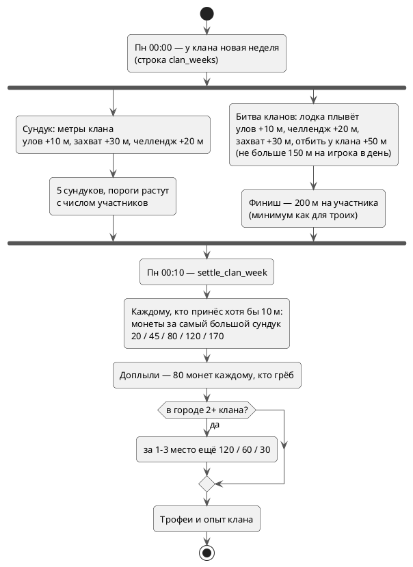

---
tags:
  - механика
  - кланы
  - схема
aliases:
  - "Сундук"
  - "Битва кланов"
  - "Регата"
source: "DOCS.md § «Сундук недели и битва кланов»"
updated: 2026-10-18
---
# Сундук недели и битва кланов

- Сервер считает очки сундука (улов +1, захват +3, челлендж +2) и метры битвы из событий недели (`_clan_week_events`): улов +1 очко / +10 м, захват +3 / +30 (у игрока другого клана +50 м), недельный челлендж +2 / +20.
- Битва кланов: потолок 150 м на игрока в сутки, финиш 200 м × участников (минимум 3).
- `get_clan_chest(clan_id)`, `get_clan_race(city)` (таблица гонки, «сегодня ты принёс», гребцы своего клана, подиум прошлой недели).
- Личный вклад: во вкладке «Сундук» экрана клана — очки каждого, во вкладке «Битва кланов» — метры каждого за неделю (`my_rowers`, с потолком 150 м в день; только для своего клана — у чужого блока нет), на экране битвы — «Гребцы клана за неделю».
- Кроны: `clan-race-tick` раз в 10 минут (уведомления «вас обогнали», не чаще раза в 3 часа, и «доплыли»); `settle_clan_week` в понедельник 00:10 по времени города (монеты, трофеи, опыт, уведомления `clan_chest_reward` / `clan_race_result`, ссылка `?race=1` открывает битву кланов).

## Битва по записи (с недели 19.10.2026)
Раньше в гонке участвовали все кланы города и метры всех членов. С понедельника 19.10.2026 неделя идёт **по записи**: клан участвует, только если глава или соруководитель открыл битву:

- **Открыть битву** может глава или соруководитель клана (минимум 3 человека в клане): экран клана → вкладка «Битва кланов» → «Участвовать в битве кланов» (`ClanWarCard` в `ClanRace.tsx`, окно `ClanWarRosterSheet.tsx`). Открыть можно в любой момент недели до воскресенья 24:00 по времени города; не открыл — клан в гонке этой недели не участвует (на карте плашка «Битва не начата», у главы — «начать»).
- **Состав**: от 3 игроков до всего клана. Кнопки «Выбрать всех» и «Снять выделение», «Выбрано N из M», рядом с каждым — аватар, имя, роль, прошлая неделя (улова и метры с дневным потолком) и время последнего улова (`get_clan_war_candidates`). По умолчанию никто не выбран, сортировка — по метрам прошлой недели. Перед стартом — подтверждение «состав изменить нельзя».
- **Старт** (`start_clan_war(clan, user_ids)`) фиксирует состав и момент старта (`clan_wars`, `clan_war_members`): считаются только метры игроков состава и только после старта; финиш — 200 м × размер состава (минимум как для троих); потолок 150 м на игрока в сутки прежний. Отмены нет, и убрать игрока из состава нельзя. **Добавить можно** (`add_clan_war_players(clan, user_ids)`, кнопка «Добавить игроков» у главы и соруководителя на карточке состава): метры добавленного идут с момента добавления (`clan_war_members.added_at`), финиш удлиняется на 200 м за каждого, добавить нельзя, если клан уже доплыл; в журнале клана — «добавил в состав игроков: N», добавленные получают то же сообщение «клан в битве, ты в составе». Ушедший или исключённый оставляет метры клану; новый член клана в эту войну попадает только если его добавят.
- **Награды** — только игрокам состава, кто принёс хотя бы 10 м: финиш 80 монет, за место 120 / 60 / 30 (если в битве два клана и больше), трофеи и опыт клана, медаль победителю. Клан не из битвы трофеев и опыта за битву не получает; штрафов нет. Одиночный клан в битве плывёт к финишу один, как раньше.
- **Сундук не менялся**: считает всех членов всех кланов, без записи и без дневного потолка.
- **Уведомления**: игрокам состава — «клан вступил в битву, ты в составе» (`clan_war_started`, приложение и Telegram); главе и соруководителям клана без битвы — «откройте битву» в понедельник в 10:00 и в воскресенье в 12:00 по времени города (`clan_war_reminder`, cron `clan-war-reminder-*`). «Вас обогнали» и «доплыли» идут только составу.
- **Переход**: недели до 19.10.2026 считаются как раньше (`_clan_war_mode(week_start)`, граница — 18.10 20:00 UTC), поэтому итоги недели 12–19.10 в ночь на 19.10 посчитаны по старым правилам. В БД: `_clan_war_events`, `_clan_race_state` (по составу), `_clan_in_race`, `_clan_war_has`, `get_clan_race` (поля `war_mode`, `my_role`, `my_war`, `can_start`; в таблице только кланы в битве), `clan_race_tick`, `_settle_clan_week_at` + обёртка `settle_clan_week`, `clan_war_reminder`. Черновики и откат — `web/supabase-drafts/hotfix-19-10/`.

## Экран клана (с 16.10.2026)
- Вкладки: «Участники» · «Битва кланов» · «Сундук» — битва, главное событие недели, идёт перед сундуком.
- Сундук показывается в метрах, как битва: очки сервера × 10 (`METERS_PER_POINT` в `ClanChestPanel.tsx`) — пороги 300 / 700 / 1200 / 1800 / 2500 м для клана из 15 человек, правила на плашках «Улов +10 м · Захват +30 м · Челлендж +20 м». В базе по-прежнему очки (`get_clan_chest`, `settle_clan_week`) — менять там ничего не пришлось. Дневного потолка у сундука нет.
- Полоса прогресса сундука: полоса на всю ширину, сундуки стоят на 10 / 30 / 50 / 70 / 90 %; заливка доходит до сундука ровно тогда, когда достигнут его порог (раньше шкала считалась как для полосы между центрами и убегала дальше второго сундука).
- Лодки в битве — гребные: корпус цветом клана, два гребца в кепках (рубашки — оттенки цвета клана, рука с тёмной кромкой, чтобы не сливалась с рубашкой), вёсла качаются, герб на флажке на корме (`RaceBoat` в `ClanRace.tsx`). Медаль «Победитель битвы кланов» — гребная лодка.

## Сундук — интерактивный (с 16.10.2026)
- Сундуки нажимаются (`ClanChestPanel.tsx`): нажатие выбирает ступень и показывает под дорожкой карточку «Сундук III» — открыт / следующий / закрыт, сколько нужно и сколько осталось, награда. У открытого сундука при нажатии поднимается крышка и вылетают монеты; открытые сундуки при входе по очереди «подпрыгивают». Закрытые — тёмные, не просвечивают дорожку.
- Метры в шапке отсчитываются от нуля (`useCountUp`), заливка дорожки переливается.
- Блок «Твой вклад» (для участников): метры, доля от сундука клана, «Тебе сейчас +N монет» (за самый большой открытый сундук) и награда следующего. В списке вкладов своя строка подсвечена («ты»), у первого — «Лучший на неделе». Новых запросов нет — всё из `get_clan_chest`.

## См. также
- [[Кланы]]
- [[Фоновые задачи (pg_cron)]]
- [[Монеты и экономика]]
